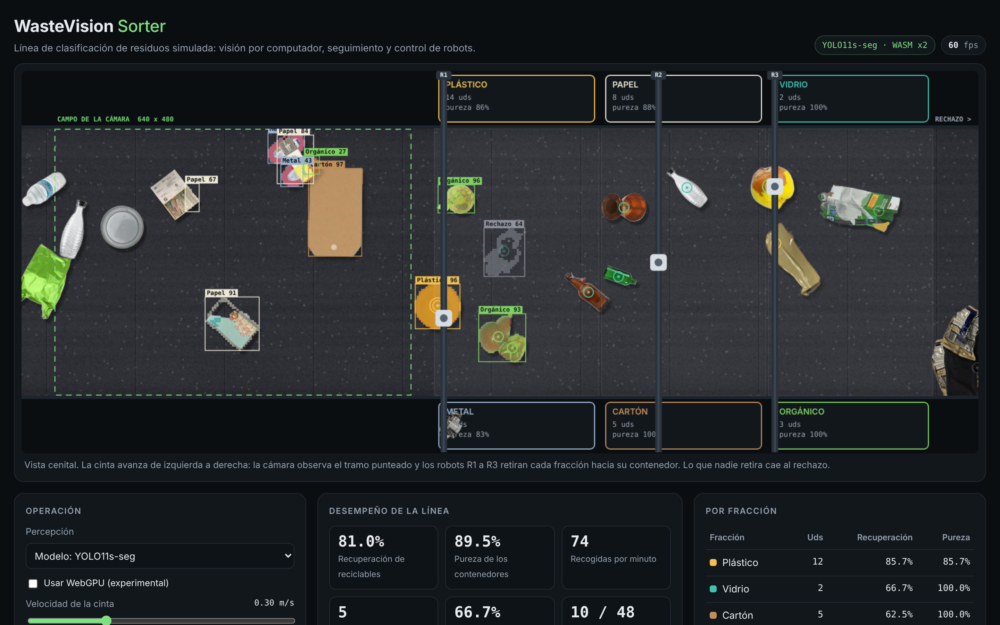

# WasteVision Sorter

A simulated robotic sorting line for recyclable waste that runs entirely in the browser. An overhead camera watches a conveyor belt, an instance segmentation network finds every object, a tracker follows it along the belt, and gantry robots intercept each object and drop it in the bin of its material.

The belt, the robots and the physics are simulated. The vision is not: the network runs on the pixels of the rendered camera frame and never has access to the simulator state.



## Pipeline

| Stage | What it does | Where |
|---|---|---|
| Camera | Captures a 640 x 480 frame of the belt (2.5 mm per pixel) | `web/js/render.js` |
| Perception | YOLO11-seg exported to ONNX, run with ONNX Runtime Web in a Web Worker. Returns mask, class, score and a grasp point for each object | `web/js/yolo-worker.js` |
| Tracking | Associates detections in belt coordinates (u = x - belt travel), so inference latency does not shift the target. The class is decided by score-weighted voting across frames | `web/js/tracker.js` |
| Allocation | Each idle robot picks a reachable target of its two fractions (earliest deadline first, nearest, or FIFO) | `web/js/control.js` |
| Planning | Solves the intercept point with the belt speed fed forward and a trapezoidal velocity profile | `web/js/control.js` |
| Control | Each axis is a double integrator with PD feedback, acceleration feed-forward and actuator saturation | `web/js/control.js` |
| Grasp | The suction cup takes whatever object is on top at the head's actual position | `web/js/world.js` |

Perception can be switched to an **oracle** (the simulator's ground truth of what is visible) to separate the errors of the vision system from the limits of the robots.

All figures on the page (recovery, purity, picks per minute) are computed against the true class of each object.

## Data

Object cutouts come from two public datasets, [TrashNet](https://github.com/garythung/trashnet) and Household Garbage (Kaggle, `mostafaabla/garbage-classification`):

1. Near-duplicate removal across sources with a perceptual hash (the second dataset contains most of the first).
2. Salient object matting with IS-Net, followed by quality filters (single component, not cut by the frame, confident alpha).
3. Split **by object**: 160 train, 25 validation and 40 simulator sprites per class. The simulator sprites are never used for training.

Training images are synthetic camera frames: cutouts composited on the belt texture with the same sizes, shadows and occlusion rule as the simulator, which gives exact masks. An object is labelled with its visible region if that region is at least 25 % of the object and 300 px.

Seven classes: plastic, glass, cardboard, metal, paper, organic, other (reject).

## Run it

```bash
node serve.mjs web 5173      # http://localhost:5173
```

Any static server works. `serve.mjs` also sends the cross-origin isolation headers that enable multi-threaded WebAssembly.

## Train the model

Open `training/WasteVision_Sorter_entrenamiento.ipynb` in Google Colab with a GPU runtime and run all cells. It generates the dataset, trains YOLO11s-seg and YOLO11n-seg, evaluates them on the unseen simulator objects and exports ONNX files to `web/models/`.

```bash
python training/make_dataset.py --out dataset --train 4000 --val 400 --test 400
python training/train_local.py --data dataset/data.yaml --epochs 10   # CPU version
```

### Current models

Both models were trained on a Colab T4 GPU with the notebook and evaluated on the test split, whose objects never appear in training. The page loads YOLO11n-seg by default because it is four times smaller and runs faster in the browser; YOLO11s-seg can be selected in the perception menu.

| Metric (test split) | YOLO11n-seg | YOLO11s-seg |
|---|---|---|
| Parameters | 2.86 M | 10.08 M |
| ONNX size | 11.6 MB | 40.5 MB |
| Epochs | 38 (early stop) | 60 |
| Mask mAP50 | 68.6% | 72.4% |
| Mask mAP50-95 | 57.8% | 62.4% |
| Mask precision / recall | 69.8% / 64.8% | 73.5% / 70.1% |
| Best class mask mAP50 | cardboard 88.2% | cardboard 88.7% |
| Worst class mask mAP50 | other 52.2% | other 59.9% |
| GPU inference (T4) | 4.2 ms | 9.0 ms |

A first YOLO11n-seg trained for 10 epochs on CPU reached 68.3% mask mAP50, close to the GPU run, so the nano model is limited by capacity rather than training time. Full numbers and confusion matrices are in `web/models/report.json`; training curves are in `docs/training/`.

## Experiments without a browser

The world, tracker and robot code have no DOM dependencies, so the same modules run in Node:

```bash
node experiments/run.mjs
```

## Repository layout

```
web/          static site (deployed as is)
  js/         world, tracker, control, renderer, perception worker
  assets/     belt texture, sprite atlas, scene parameters
  models/     ONNX models and their evaluation report
  vendor/ort/ ONNX Runtime Web (WASM build)
training/     dataset generator, notebook, sprite cutouts
tools/        cutout extraction and asset build scripts
experiments/  headless simulation
```

## Limits

- Images are composites of real cutouts, not photographs of a real belt. Lighting, dirt, deformation and motion blur of a real plant are not represented.
- Objects lie flat and do not move relative to the belt. There is no collision or stacking physics beyond draw order.
- The grasp model is a point contact with a fixed failure probability.

## Licences and credits

Code: MIT. The trained weights derive from Ultralytics YOLO11 (AGPL-3.0). TrashNet is MIT licensed; Household Garbage is distributed on Kaggle by its author. ONNX Runtime Web is MIT licensed.

Course project for Control and Intelligent Agents, Universidad del Norte.
